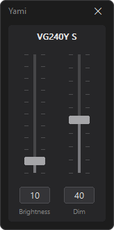

<p align="center">
  
</p>

<h1 align="center">Yami</h1>

<p align="center">Monitor brightness and dimming from the Windows tray.</p>

<p align="center">
  
</p>

Yami (闇 "darkness") is a small tray app that controls monitor brightness and can dim the screen further than the monitor itself allows. It runs as a single exe and doesn't need installing.

## Features

- Brightness control for external monitors (DDC/CI)
- Extra dimming for any display (including laptops)
- Each monitor has its own dim level
- `Ctrl+Alt+Shift+D` turns off dimming on all displays
- Can start with Windows and stay in the tray

## Installation

#### Requirements

- Windows 10 (1703 or later) or Windows 11
- Brightness control needs DDC/CI turned on in the monitor's on-screen menu. Displays without it (like most laptop screens) only get dimming.

#### Download

1. Download `Yami.exe` from the [latest release](../../releases/latest).
2. Run it. Yami adds its icon to the tray and opens the panel.
3. Turn on **Run at startup** in the tray menu if you want Yami to start with Windows.

#### Uninstall

1. Turn off **Run at startup** in the tray menu and exit Yami.
2. Delete `Yami.exe` and the `HKCU\Software\Yami` registry key.
3. If you unlocked [stronger dimming](#stronger-dimming), also delete the `GdiIcmGammaRange` value.

## Usage

#### Controls

- Left-click the tray icon to show or hide the panel and right-click it for the menu.
- Drag a slider or scroll over it to move by 1. Clicking the track jumps by 10.
- Press `Esc` or the close button to hide the panel.
- Use Exit in the tray menu to quit. Quitting only turns off the extra dimming, but hardware brightness stays where you set it.

#### Stronger dimming

By default Windows doesn't let gamma dimming go past 50%. The **Unlock stronger dimming** option raises the limit to 90% by setting the registry value below.

> [!NOTE]
> Needs admin rights and applies to all users, and takes effect after a restart.

```
HKLM\SOFTWARE\Microsoft\Windows NT\CurrentVersion\ICM\GdiIcmGammaRange = 256 (DWORD)
```

Delete the value to undo it.

## Build (Developers)

Requires Visual Studio 2022 or Build Tools with the C++ desktop workload.

```
build.bat
```

The exe is written to `build\Yami.exe`.

---

#### Credits: Created by Claude Opus 5.5
#### License: [MIT](LICENSE)


